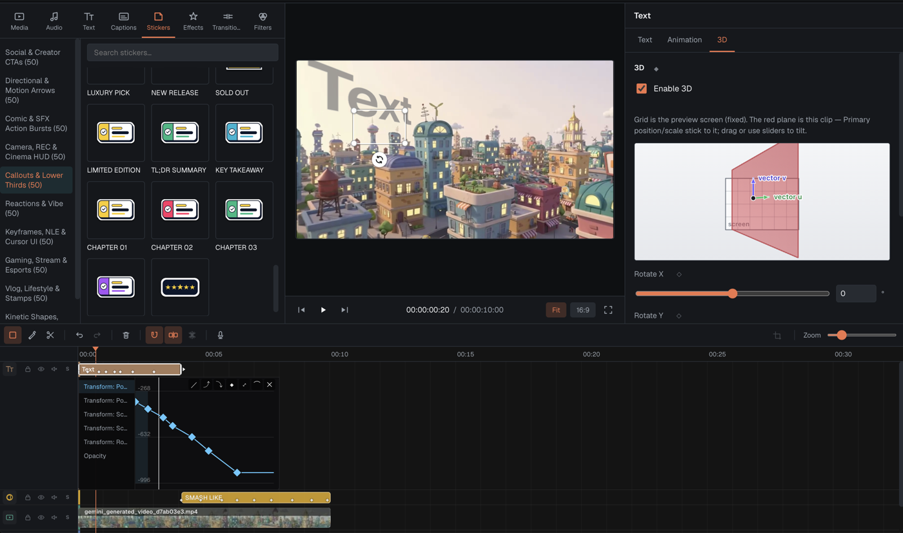
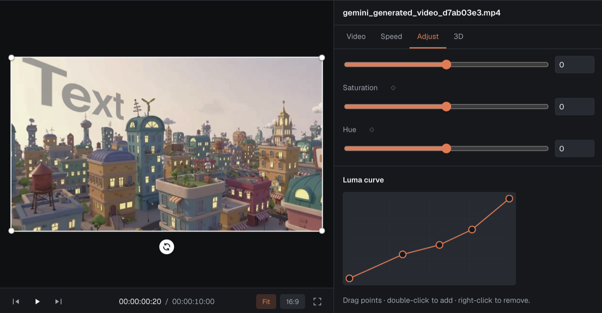

# 

# IndieCut: The Open-Source CapCut Substitute

> Expert multitrack video editing on a desktop and in a browser.  
> **Watermarks are absent. No paywall for Pro. No subscriptions.** Only your timeline.

Built with Electron, React, and Vite, this robust, open-source video editor offers timeline editing, keyframe animation, custom LUTs, 500 SVG stickers, captions, AI background helpers, and export. The same editor can be used as a browser PWA or as a desktop application.

[](https://app.indiecut.io)
[](https://github.com/Indiecut/indiecut/releases/latest/download/IndieCut-mac-arm64.dmg)
[](https://github.com/Indiecut/indiecut/releases/latest/download/IndieCut-win-x64-setup.exe)
[](https://github.com/Indiecut/indiecut/releases)
[](LICENSE)

[Intel Mac (.dmg)](https://github.com/Indiecut/indiecut/releases/latest/download/IndieCut-mac-x64.dmg)

**Try now:** [app.indiecut.io](https://app.indiecut.io)  
**Website:** [indiecut.io](https://indiecut.io)  
**Source:** [github.com/Indiecut/indiecut](https://github.com/Indiecut/indiecut)  
**Version:** 1.1.0  
**License:** [MIT](LICENSE)

## Why Use IndieCut?

- **Unrestricted** - LUTs, captions, effects, filters, and stickers are always free. No premium levels.
- **Zero-friction** - Download for Mac or Windows or launch the browser application to begin cutting. There is no 2GB installer tax.
- **Hackable** - Modern web stack (React, Vite, Electron). You can create your own video workflows, embed it, or fork it.

## Features

- Video, audio, text, stickers, captions, and effects in a multi-track timeline
- Canvas preview with 3D plane controls, masks, blend modes, and transformations
- 500 editable text templates and 500 kinetic SVG stickers
- Speech assistants and captions (on-device via Transformers.js + ONNX Runtime)
- Text animations, filters (LUTs), sound effects, and transitions
- Export using the web build (download/save picker) or Electron packaging (`electron-builder`)

## Editor showcase

One workspace with a multitrack timeline, sticker library, 3D text plane, and keyframe graph:

<p align="center">
  
</p>

Keyframeable brightness, saturation, hue, and a luma curve are used to adjust color:

<p align="center">
  
</p>

## Requirements

- **Node.js** 20+ (suggested)
- **npm** 10+
- Linux (Electron), Windows, or macOS; contemporary Chromium for the web build

## Quick start

```bash
git clone https://github.com/Indiecut/indiecut.git
cd indiecut
npm install
npm run dev
```

This launches the Electron shell and the Vite development server.

### Web build (local)

```bash
npm run dev:web
```

Vite PWA can be accessed at **http://localhost:5174**. The browser is where projects are kept (OPFS). Static output of production:

```bash
npm run build:web
```

The output ends up in `apps/web/dist`; use your preferred static host to serve that folder.

### Useful scripts

| Script | Description |
| --- | --- |
| `npm run dev` | Desktop program (Electron + Vite) |
| `npm run dev:web` | Web PWA (Vite on port 5174) |
| `npm run build` | Build the production desktop renderer |
| `npm run build:web` | Web build for production → `apps/web/dist` |
| `npm run typecheck` | Check for TypeScript in every workspace |
| `npm run test:unit` | Unit tests |
| `npm run pack` | Electron build without packaging |
| `npm run dist:mac` | macOS DMGs using electron-builder (arm64 + x64) |
| `npm run dist:win` | NSIS installer (`.exe`) for Windows using electron-builder |
| `npm run dist` | Windows and macOS packages (platform host permitting) |

## Downloads / releases

| Platform | Download |
| --- | --- |
| macOS Apple Silicon | [IndieCut-mac-arm64.dmg](https://github.com/Indiecut/indiecut/releases/latest/download/IndieCut-mac-arm64.dmg) |
| macOS Intel | [IndieCut-mac-x64.dmg](https://github.com/Indiecut/indiecut/releases/latest/download/IndieCut-mac-x64.dmg) |
| Windows x64 | [IndieCut-win-x64-setup.exe](https://github.com/Indiecut/indiecut/releases/latest/download/IndieCut-win-x64-setup.exe) |

**Ship a release**

1. When necessary, raise the `"version"` in the root and workspace `package.json` files
2. Commit, then tag: `git tag v1.1.0 && git push origin v1.1.0`
3. Installers for Mac and Windows are created by the [Release](.github/workflows/release.yml) workflow and published on that tag

**Build locally**

```bash
# macOS host → .dmg files in release/
npm run dist:mac

# Windows host → NSIS setup .exe in release/
npm run dist:win

# Web → apps/web/dist
npm run build:web
```

By default, installers are unsigned. If the app is blocked by Gatekeeper on macOS, right-click → **Open** the first time. SmartScreen may need **More info** on Windows, but you can still **Run anyway**.

## Project layout

```
apps/desktop/       Electron shell + desktop platform bridge
apps/web/           Browser PWA + OPFS platform bridge
packages/editor/    Shared React editor (timeline, compositor, export)
packages/platform/  Shared platform bridge types/runtime
assets/             Stickers, fonts, SFX, effects, templates
public/             Static assets (incl. ORT WASM copies)
scripts/            Install / asset helpers
```

## License & notices

- IndieCut-original assets and application source: **MIT** - see [LICENSE](LICENSE)
- Fonts and third-party software: **[NOTICE.md](NOTICE.md)** and `assets/fonts/LICENSE.md`
- When altering or redistributing **mediabunny**, abide by the terms of its **MPL-2.0** license

## Contributing

Refer to [CONTRIBUTING.md](CONTRIBUTING.md) and the [Code of Conduct](CODE_OF_CONDUCT.md).

## Security

See [SECURITY.md](SECURITY.md) for a private way to report vulnerabilities.

## Links

- Try now: [https://app.indiecut.io](https://app.indiecut.io)
- Website: [https://indiecut.io](https://indiecut.io)
- GitHub: [https://github.com/Indiecut/indiecut](https://github.com/Indiecut/indiecut)
- Issues: [https://github.com/Indiecut/indiecut/issues](https://github.com/Indiecut/indiecut/issues)

## Trademark

This project may be referred to by the app icon and the trademark “IndieCut.” Without the maintainers' consent, do not imply official support for forks.
